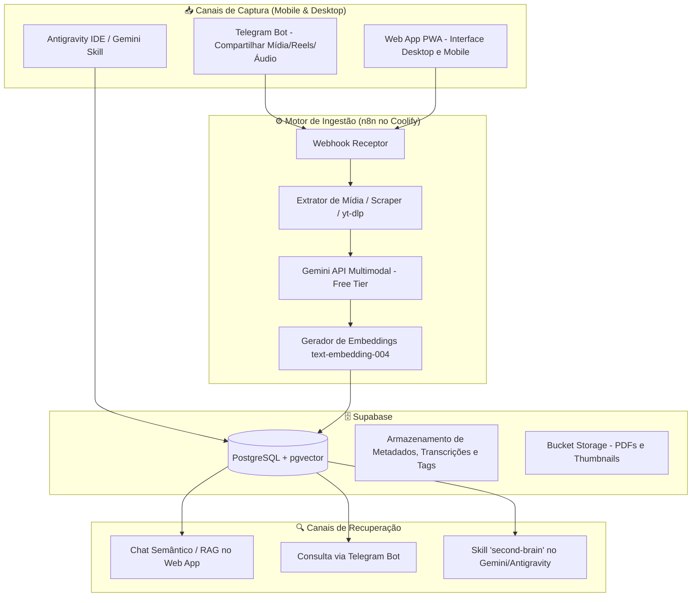

# 🧠 Segundo Cérebro (Second Brain AI) - Documentação do Projeto

**Versão:** 0.2.1  
**Status:** Produção ativa em https://2cerebro.scaladigital.com.br com CI/CD Auto-Deploy  
**Última Atualização:** 14/10/2026  

---

## 📌 1. Visão Geral

O **Segundo Cérebro AI** é um ecossistema pessoal de captura, processamento cognitivo e recuperação de conhecimento multimodal (Links, Reels/TikTok/YouTube, Áudios, PDFs, Textos).

O objetivo principal é **atrito zero** na captura (salvar direto do celular ou desktop) e **inteligência contextual** na recuperação (conversar com seus arquivos e notas, fazer buscas semânticas e ativar habilidades via Gemini).

---

## 🏗️ 2. Arquitetura da Solução (100% Free Tier)

---

## 🧩 3. Componentes do Ecossistema

### 3.1. Supabase (Banco Vetorial & Metadados)
- **Extensão:** `pgvector` para busca por proximidade vetorial (Cosine Distance).
- **Tabelas Principais:**
  - `brain_items`: registro de cada item (título, resumo, conteúdo transcrito/extraído, tipo, URL de origem, tags, metadata JSON).
  - `brain_chunks`: fragmentos de texto com embeddings vetoriais (768 dimensões) para RAG de alta fidelidade.
- **Função RPC:** `match_brain_chunks` para busca híbrida (semântica + palavras-chave).

### 3.2. n8n (no servidor Coolify)
- Atua como backend orquestrador sem custo de servidor dedicado.
- Recebe webhooks do Telegram e do Web App.
- Faz download seguro de mídias (áudio de Reels/vídeos, PDFs).
- Envia payload diretamente para a API do Google Gemini (1.5 Flash / 2.0 Flash) que suporta áudio, vídeo e PDFs nativamente.
- Salva dados estruturados e vetores no Supabase.

### 3.3. IA Multimodal (Google Gemini Free Tier)
- **Extração Semântica:** O Gemini analisa o áudio/vídeo/documento, transcreve, sintetiza ideias centrais, extrai pessoas citadas, links úteis e gera tags sugeridas.
- **Embeddings:** `text-embedding-004` (768 dimensões) para indexação vetorial.

### 3.4. Interfaces de Acesso & Consulta
1. **Telegram Bot (Captura & Consulta Rápida Mobile):**
   - Melhor canal móvel: basta compartilhar qualquer link do Instagram/YouTube direto para o bot pelo botão "Compartilhar" do smartphone.
   - Envio de mensagens de voz instantâneas para virarem notas estruturadas.
2. **Web App PWA (Visualização, Gestão & Chat Central):**
   - Painel elegante (Dark mode, design premium, responsivo).
   - Busca em tempo real, visualização de cartões, filtros por tags e tipo de mídia.
   - Aba "Conversar com meu Cérebro" (Chat RAG).
3. **Skill do Antigravity/Gemini (`skills/second-brain`):**
   - Permite consultar o Segundo Cérebro diretamente nas sessões de trabalho no IDE com comandos como: `"O que eu salvei sobre tal assunto no meu segundo cérebro?"`.

## 📋 4. Status de Execução do MVP

- [x] **Fase 1: Infraestrutura de Dados (Supabase)**
  - Extensões `vector` (pgvector 0.8.2) e `uuid-ossp` habilitadas.
  - Tabelas criadas: `public.brain_items` e `public.brain_chunks`.
  - Índices criados: HNSW para embeddings (`vector_cosine_ops`), GIN para `tags`, B-tree para `created_at` e `source_type`.
  - Função RPC criada: `public.match_brain_chunks` para busca vetorial semântica (RAG).
- [x] **Fase 2: Pipeline de Ingestão Multimodal (n8n + Gemini API)**
  - Workflow exportado em `n8n/second_brain_workflow.json` pronto para importação no Coolify.
  - Análise multimodal com Gemini 2.0 Flash e geração de embeddings com `text-embedding-004`.
  - Documentação passo a passo em `n8n/README.md`.
- [x] **Fase 3: Web App PWA (Captura via Compartilhar + Visualizador de Notas + Chat RAG)**
  - PWA funcional com Web Share Target API configurada em `manifest.json`.
  - Dashboard moderno com cards por tipo (Reels, YouTube, Áudios, PDFs, Artigos, Notas).
  - Modal de detalhes rico com transcrição, pontos-chave e **exportador para Markdown (.md) compatível com Obsidian**.
  - Aba de Chat Conversacional para perguntar sobre as anotações do acervo.
- [x] **Fase 4: Skill do Gemini / Antigravity (`skills/second-brain`)**
  - Skill global criada em `C:\Users\torre\.gemini\config\skills\second-brain\SKILL.md`.
  - Cópia do workspace em `.agents\skills\second-brain\SKILL.md`.
  - Gatilho inteligente para o usuário dizer "segundo cérebro" e ativar consultas imediatas no Supabase.

